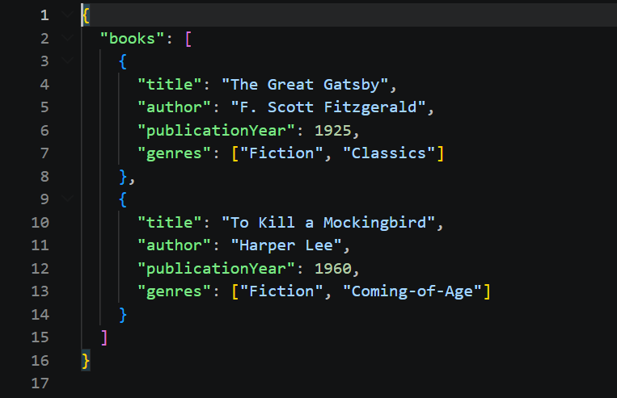
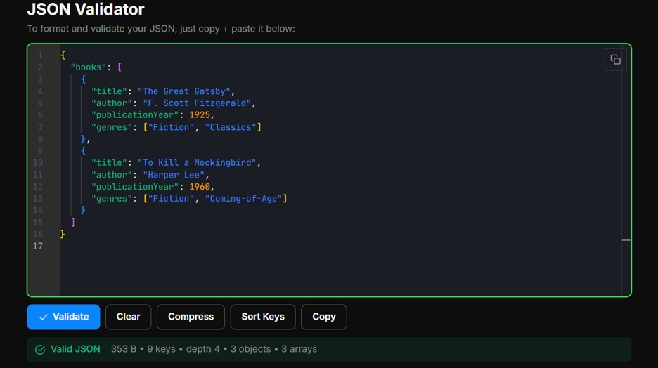
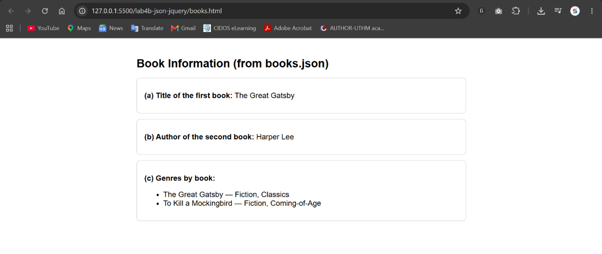
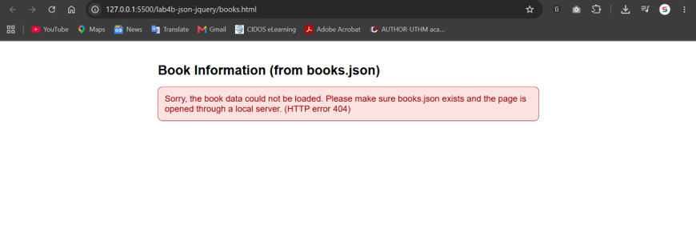
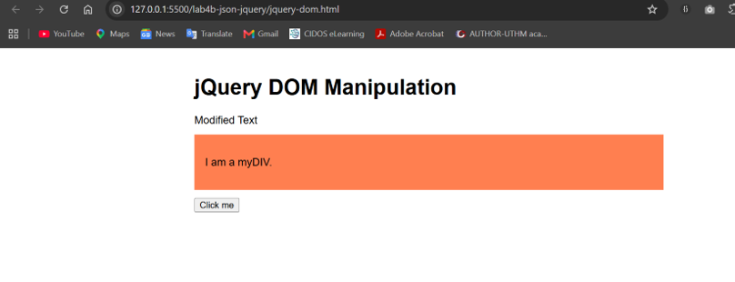
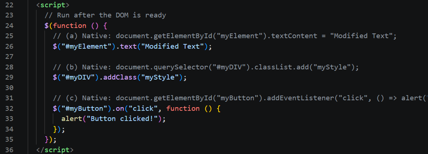

# Lab 4b – Client-Side Scripting (JSON and jQuery)

**Course:** BIC21203 Web Development (Session 2026/2027)
**Name:** Muhammad Syawal Fanzury Bin Mohd Azri
**Matric No.:** CI250115

## Files

| File | Description |
|------|-------------|
| `books.json` | Q1 – Valid JSON dataset with a top-level `books` array (2 books) |
| `books.html` | Q2 – Uses `fetch()` + `async/await` to load `books.json` and display data safely with `textContent` / `createElement()` |
| `jquery-dom.html` | Q3 – jQuery 4.0.0 equivalents of three native DOM operations |
| `screenshots/` | Output screenshots |

## Setup Instructions

1. Clone the repository:
   ```bash
   git clone https://github.com/Syawalfanz/lab4b-json-jquery.git
   cd lab4b-json-jquery
   ```
2. Open the folder in **VS Code**.
3. Install the **Live Server** extension (by Ritwick Dey).
4. Right-click `books.html` → **Open with Live Server**.
   The page opens at `http://127.0.0.1:5500/books.html`.
   > Do **not** open `books.html` by double-clicking (`file://`), because browsers block `fetch()` on local files.
5. Open `jquery-dom.html` the same way (an internet connection is needed to load jQuery from the CDN).

## Expected Output

**books.html**
- (a) The Great Gatsby
- (b) Harper Lee
- (c) The Great Gatsby — Fiction, Classics; To Kill a Mockingbird — Fiction, Coming-of-Age

**jquery-dom.html**
- `#myElement` shows "Modified Text"
- `#myDIV` has a coral background with padding
- Clicking the button shows an alert "Button clicked!"

## Screenshots

### Q1 – books.json



### Q2 – books.html



### Q3 – jquery-dom.html


